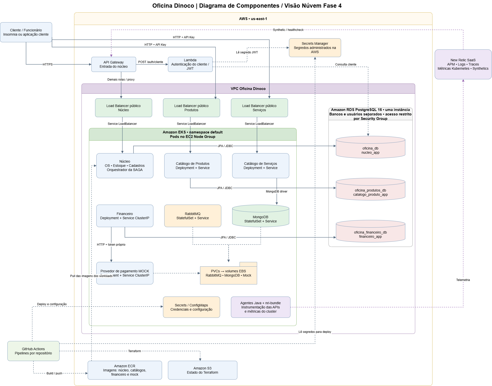

# 🚗 API Oficina Mecânica Dinoco

Núcleo da **Oficina Mecânica Dinoco**, desenvolvido para o Tech Challenge de Arquitetura de Software da FIAP. A aplicação coordena o ciclo das ordens de serviço (OS), do atendimento à entrega, incluindo orçamentos, estoque, execução e pagamento. Catálogos e financeiro possuem APIs e dados próprios.

## Visão geral

O sistema permite cadastrar clientes, funcionários e veículos; abrir e acompanhar ordens de serviço; diagnosticar problemas; incluir produtos e serviços no orçamento; registrar aprovação ou reprovação; executar o trabalho; e concluir a entrega. Também contempla rastreio pelo cliente, envio de orçamento por WhatsApp, movimentações de estoque e métricas de execução.

O projeto utiliza **Domain-Driven Design (DDD)** e **Clean Architecture** para separar regras de domínio, casos de uso e adaptadores de infraestrutura.

## Arquitetura da solução



| Componente | Responsabilidade | Persistência |
| --- | --- | --- |
| **Núcleo (`oficina-dinoco`)** | OS, clientes, veículos, funcionários, estoque, métricas e orquestração da Saga de pagamento. | PostgreSQL |
| [**Catálogo de produtos**](https://github.com/JacksonPriess/oficina-produto-api) | Cadastro e consulta de produtos; publicação do evento de cadastro. | PostgreSQL próprio |
| [**Catálogo de serviços**](https://github.com/JacksonPriess/oficina-servico-api) | Cadastro e consulta de serviços, preços e tempos estimados. | MongoDB |
| [**Financeiro**](https://github.com/JacksonPriess/oficina-financeiro-api) | Criação, aprovação e estorno de pagamentos; integração com provedor simulado. | PostgreSQL próprio |

O núcleo consulta os catálogos por HTTP com autenticação por `X-API-Key`. Ao adicionar itens à OS, registra o preço aplicado naquele momento, preservando o valor de itens existentes mesmo quando há alterações posteriores no catálogo.

O núcleo, o catálogo de produtos e o financeiro utilizam **RabbitMQ compartilhado**. O catálogo de serviços é consultado por HTTP. O estoque é inicializado a partir do evento de cadastro de produto, processado assincronamente pelo núcleo.

Os três bancos PostgreSQL utilizam credenciais de aplicação separadas no RDS. O catálogo de serviços com MongoDB foi validado localmente; seu deploy no EKS é uma etapa posterior. O ambiente local dessa aplicação parte de um MongoDB vazio e recebe os cadastros pela API.

## Tecnologias utilizadas

| Área | Tecnologias |
| --- | --- |
| API e segurança | Java 21, Spring Boot 4.0.6, Spring Web MVC, Spring Security, JWT, Springdoc OpenAPI e Swagger UI |
| Comunicação | Spring RestClient, Spring AMQP e RabbitMQ |
| Dados | PostgreSQL 16, Spring Data JPA, Flyway; MongoDB 8 e Spring Data MongoDB no catálogo de serviços |
| Testes | Maven Wrapper, JUnit 5, Mockito, REST Assured, Testcontainers, **Cucumber, Gherkin**, Awaitility e JaCoCo |
| Infraestrutura e entrega | Docker, Docker Compose, Terraform, GitHub Actions, Kubernetes, Amazon EKS, ECR e RDS |
| Integrações e observabilidade | AWS Lambda, API Gateway, AWS Secrets Manager, Spring Boot Actuator, logs estruturados e New Relic |

## Como executar localmente

### Pré-requisitos

- Docker com Docker Compose.
- Java 21 para executar o núcleo pelo IntelliJ IDEA ou Maven Wrapper.
- Repositórios dos serviços necessários ao fluxo que será testado.

Os comandos Docker Compose devem ser executados **na raiz do repositório correspondente**. Para integração entre containers, conecte os serviços à rede Docker compartilhada `dinoco-local`. Confira a configuração de rede, os nomes dos serviços e as credenciais nos arquivos Compose e de ambiente de cada projeto.

### 1. Iniciar as dependências e os microserviços

1. Inicie o RabbitMQ compartilhado na rede `dinoco-local` e suba o [catálogo de produtos](https://github.com/JacksonPriess/oficina-produto-api) conforme as instruções do repositório.
2. No [catálogo de serviços](https://github.com/JacksonPriess/oficina-servico-api), execute `docker compose up --build -d`. Cadastre os serviços pela API; utilize os IDs retornados ao montar a OS.
3. Para exercitar pagamento e entrega, no [financeiro](https://github.com/JacksonPriess/oficina-financeiro-api), execute `docker compose up --build -d postgres-financeiro provedor-mock`. Inicie a API financeira com os perfis `local,rabbit`, conectada ao mesmo RabbitMQ. Consulte o [guia da Saga](docs/saga-pagamento.md) para as variáveis e os testes.

### 2. Iniciar o núcleo

**Opção A — Docker:** na raiz do repositório do núcleo, execute:

```bash
docker compose up --build -d
```

**Opção B — IntelliJ IDEA:** inicie somente o banco do núcleo:

```bash
docker compose up -d postgres
```

Depois execute a API no IntelliJ com os perfis Spring `dev,rabbit`.

### 3. Configurar a comunicação

| Variável no núcleo | API pela IDE ou Maven local | API em container Docker |
| --- | --- | --- |
| `CATALOGO_PRODUTO_URL` | `http://localhost:8081` | `http://catalogo-produto-api:8081` |
| `CATALOGO_SERVICO_URL` | `http://localhost:8083` | `http://catalogo-servico-api:8083` |
| `RABBITMQ_HOST` | `localhost` | `rabbitmq` |

Configure `CATALOGO_API_KEY` e `CATALOGO_SERVICO_API_KEY` de acordo com os valores usados pelos catálogos. Os serviços de mensageria devem compartilhar broker, credenciais e *virtual host*. **Os nomes de host Docker acima pressupõem que os serviços estejam disponíveis com esses nomes na rede compartilhada.**

### 4. Verificar a inicialização

- [Swagger UI do núcleo](http://localhost:8080/swagger-ui/index.html)
- Health check: `GET http://localhost:8080/actuator/health/readiness`
- Logs da API iniciada pelo Compose: `docker compose logs -f api`

## Fluxos de negócio e integrações

### Ordem de serviço

O fluxo principal compreende abertura da OS, diagnóstico, inclusão de produtos e serviços, envio e decisão do orçamento, verificação de estoque, execução dos itens, finalização técnica e conclusão. O cliente pode acompanhar a OS mediante autenticação e vínculo com o recurso.

### Estoque e eventos

O catálogo de produtos publica eventos de cadastro. O núcleo consome esses eventos para criar o saldo inicial e registrar movimentações, sem exigir sincronização HTTP de estoque.

### Saga de pagamento

Quando a OS é finalizada tecnicamente e há valor a cobrar, o núcleo solicita o pagamento de forma assíncrona. A **aprovação financeira** libera a entrega; o estorno antes da entrega funciona como compensação e impede a conclusão.

| Fluxo | Chave de roteamento | Fila |
| --- | --- | --- |
| Produtos → núcleo | `produto.cadastrado.v1` | `nucleo.estoque.produto-cadastrado` |
| Núcleo → financeiro | `pagamento.criar.v1` | `financeiro.pagamento.criar` |
| Núcleo → financeiro | `pagamento.estornar.v1` | `financeiro.pagamento.estornar` |
| Financeiro → núcleo | `pagamento.criado.v1`, `pagamento.aprovado.v1`, `pagamento.estornado.v1` | `nucleo.financeiro.eventos` |

A **outbox** registra mensagens pendentes na mesma transação das mudanças de negócio, permitindo publicação posterior. O processamento de mensagens repetidas evita efeitos duplicados. Após tentativas de processamento malsucedidas, mensagens rejeitadas são encaminhadas a filas de falha (*dead-letter queues*, DLQs), com sufixo `.dlq`.

Para detalhes, consulte o [roteiro da Saga de pagamento](docs/saga-pagamento.md) e o [diagrama de orquestração](docs/architecture/saga-pagamentos-fase04.png).

## Estratégia de testes

A aplicação utiliza testes unitários e de componentes para casos de uso, regras de domínio, contratos HTTP, mapeamentos, segurança e mensageria.

### Testes unitários, integração e cobertura

O projeto possui o perfil Maven `cobertura-80`, que **verifica a meta de 80% de cobertura de linhas** por meio do JaCoCo quando executado explicitamente. A existência desse perfil não significa que a cobertura já tenha atingido o mínimo, nem que essa verificação seja executada automaticamente em todos os builds.

```bash
./mvnw clean verify -Pcobertura-80
```

### BDD com Cucumber e Gherkin

O projeto utiliza **BDD (Behavior-Driven Development)** para validar o fluxo principal de sucesso da oficina. O comportamento esperado é descrito em **Gherkin**, usando os termos `Dado`, `Quando` e `Então`. O **Cucumber** executa os cenários automatizados, usando **REST Assured** para as chamadas HTTP e **Awaitility** para aguardar o resultado das operações assíncronas.

O cenário abrange cadastro dos dados, abertura da OS, inclusão de itens dos catálogos, reserva e baixa de estoque, finalização técnica, pagamento assíncrono e entrega após aprovação, com as aplicações em execução.

A execução utiliza o perfil Maven `bdd`, independente do perfil de cobertura `cobertura-80`. Consulte [configuração, execução e relatórios do BDD](docs/bdd/BDD_README.md) e a [evidência de execução](docs/bdd/EvidenciaBddFluxoCompleto.pdf).

### Testes manuais com Insomnia

A [collection do Insomnia](docs/api/oficina-dinoco-insomnia-collection.yaml) reúne as requisições na ordem do fluxo da OS, da autenticação à conclusão. Para importá-la, use **Import/Export > Import Data > From File** no Insomnia.

Nos testes que envolvem cobrança, siga também o [roteiro integrado de aprovação de pagamento](docs/saga-pagamento.md#roteiro-de-teste-integrado) após a finalização técnica da OS.
## Segurança e autenticação

- **Funcionários:** autenticação por e-mail e senha, com JWT e perfis `ADMIN`, `MECANICO` e `ATENDENTE`.
- **Clientes:** autenticação por CPF via API Gateway e AWS Lambda; o JWT identifica o cliente por ID interno, sem incluir o CPF.
- **Rastreio e decisão sobre orçamento:** exigem JWT do tipo `CLIENTE` e validação do vínculo entre o cliente e a OS.
- **Webhooks simulados:** possuem header de proteção específico, sem a mesma autenticação JWT das rotas de usuário.

Detalhes de fluxos, rotas, perfis, respostas HTTP e credenciais de teste locais estão em [Autenticação e autorização](docs/security/autenticacao.md).

## Infraestrutura e deploy

A infraestrutura da solução utiliza repositórios e pipelines independentes para o núcleo, o banco, os recursos Kubernetes e a autenticação serverless.

1. Provisione o cluster e o RabbitMQ pelo [repositório Kubernetes](https://github.com/JacksonPriess/oficina-infra-k8s).
2. Provisione o RDS e prepare bancos e usuários pelo [repositório de banco](https://github.com/JacksonPriess/oficina-infra-db).
3. Publique a [Lambda de autenticação](https://github.com/JacksonPriess/oficina-auth-lambda) para disponibilizar a chave JWT compartilhada.
4. Publique o catálogo de produtos, o financeiro e o núcleo.
5. Execute o workflow do API Gateway após a criação do Load Balancer do núcleo. Configure a integração New Relic pelo repositório Kubernetes.

Consulte também a [evolução arquitetural do Tech Challenge](docs/architecture/evolucao-tech-challenge.md), incluindo a separação da infraestrutura na Fase 03.

## Documentação complementar

**Negócio e execução**

- [Linguagem ubíqua e dicionário de dados](docs/negocio/linguagem_ubiqua.md)
- [Guia da Saga de pagamento e roteiro de testes](docs/saga-pagamento.md)
- [BDD — preparação, execução e relatórios](docs/bdd/BDD_README.md)
- [Collection do Insomnia](docs/api/oficina-dinoco-insomnia-collection.yaml)

**Arquitetura e diagramas**

- [Diagrama de componentes — Fase 04](docs/architecture/component-diagram-fase04.png)
- [Saga de pagamentos orquestrada pelo núcleo](docs/architecture/saga-pagamentos-fase04.png)
- [Sequência de abertura da OS — Fase 04](docs/architecture/service-order-sequence-fase04.md)
- [Sequência de autenticação](docs/architecture/authentication-sequence.png)
- [Arquitetura interna da aplicação](docs/diagramas-fase2/DiagramaComponentesArquitetura.png)
- [Fluxo geral de deploy](docs/diagramas-fase2/oficina-dinoco-fluxo-deploy-geral.drawio.png)
- [Modelo entidade-relacionamento do banco](docs/database/database-er-diagram.png)
- [Justificativa de banco de dados](docs/database/database-justification.md)

**Decisões arquiteturais (ADRs) e propostas técnicas (RFCs)**

- [RFC-001 — Provedor de nuvem](docs/rfc/RFC-001-cloud-provider.md)
- [RFC-002 — Banco de dados](docs/rfc/RFC-002-database.md)
- [RFC-003 — Estratégia de autenticação](docs/rfc/RFC-003-authentication.md)
- [ADR-001 — API Gateway](docs/adr/ADR-001-api-gateway.md)
- [ADR-002 — Amazon EKS](docs/adr/ADR-002-eks.md)
- [ADR-003 — Escalabilidade HPA](docs/adr/ADR-003-hpa.md)
- [ADR-004 — JWT](docs/adr/ADR-004-jwt-stateless.md)
- [ADR-005 — Observabilidade](docs/adr/ADR-005-new-relic.md)
