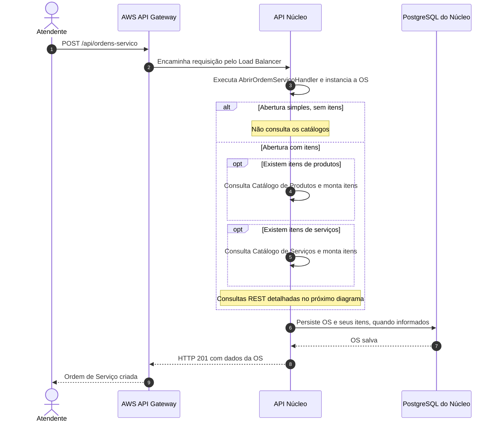
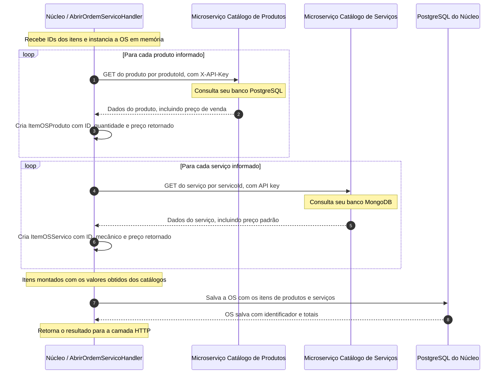

# Diagrama de Sequência — Abertura de Ordem de Serviço

## Objetivo

Esta documentação representa as duas formas de abertura de uma Ordem de Serviço (OS):

- abertura simples, sem itens de produtos ou serviços;
- abertura com itens, consultando os microserviços de Catálogo de Produtos e Catálogo de Serviços antes de persistir a OS.

O fluxo foi dividido em duas visões para facilitar a leitura: entrada da requisição e consultas aos catálogos. A aplicação Núcleo é responsável pela OS; cada catálogo mantém seus próprios dados.

## Fluxo geral de abertura da Ordem de Serviço

O diagrama apresenta o caminho de sucesso. As chamadas aos catálogos acontecem antes de salvar a OS. Quando a requisição contém apenas produtos ou apenas serviços, somente o catálogo correspondente é consultado.

## Detalhamento — abertura com produtos e serviços

Os nomes das operações GET são descritivos; os caminhos HTTP concretos são definidos pelos adaptadores de integração de cada catálogo.

## Responsabilidades e origem dos dados

| Informação | Origem | Utilização no núcleo |
| --- | --- | --- |
| Identificador do produto e quantidade | Requisição de abertura | Identificam o produto e a quantidade do item da OS. |
| Preço de venda do produto | API do Catálogo de Produtos, com persistência em PostgreSQL | Copiado para o valor unitário de venda do item da OS. |
| Identificador do serviço e mecânico | Requisição de abertura | Identificam o serviço e o profissional associado ao item. |
| Preço padrão do serviço | API do Catálogo de Serviços, com persistência em MongoDB | Copiado para o valor cobrado do item da OS. |
| OS e seus itens | Núcleo | Persistidos no banco PostgreSQL do núcleo. |

## Integração e Clean Architecture

O `AbrirOrdemServicoHandler` coordena a criação por meio das interfaces `CatalogoProdutoGateway`, `CatalogoServicoGateway` e `OrdemServicoCommandGateway`.

- `CatalogoProdutoGateway.buscarPrecoVendaAtual(produtoId)` obtém o preço do produto.
- `CatalogoServicoGateway.buscarPrecoPadrao(servicoId)` obtém o preço do serviço.
- `OrdemServicoCommandGateway.salvar(novaOs)` persiste a OS com os itens montados.

As implementações dos gateways na infraestrutura realizam as chamadas REST e enviam a API key. O domínio não conhece HTTP, credenciais ou detalhes dos bancos dos catálogos. Os participantes “Núcleo” nos diagramas agrupam essas camadas para evitar excesso de elementos visuais.

No Kubernetes, o núcleo acessa os catálogos pelos endereços internos dos Services. Essas consultas não precisam passar pelo API Gateway nem pelos Load Balancers públicos dos catálogos. O núcleo também não consulta diretamente os bancos dos microserviços.

## Valores da OS e tratamento de falhas

Os preços retornados são copiados para os itens da OS no momento da abertura. Uma alteração posterior no catálogo não atualiza automaticamente uma OS já criada; os valores dos itens permanecem sob responsabilidade do núcleo.

Se um produto ou serviço não for encontrado, ou se a consulta ao catálogo falhar sem recuperação, a abertura é interrompida antes de persistir a OS. O tratamento de exceções da API define a resposta HTTP correspondente. Os diagramas não representam esses caminhos de erro.

## Estoque, mensageria e pagamento

As consultas de produtos e serviços durante a abertura são síncronas via REST. Não há publicação no RabbitMQ para obter esses preços.

A abertura da OS não reserva nem retira peças do estoque. A reserva pertence ao fluxo de aprovação do orçamento, e a retirada ocorre no início da execução. O evento de cadastro de um novo produto, que inicializa seu saldo no núcleo, é um fluxo assíncrono separado.

A cobrança também não ocorre na abertura: a SAGA de pagamento é iniciada após a finalização da execução da OS, conforme as regras do fluxo financeiro.

## Observabilidade

Durante o processamento, as aplicações instrumentadas enviam logs, traces e métricas ao New Relic. Essa telemetria permite acompanhar a criação da OS e investigar falhas nas consultas aos catálogos. O New Relic foi omitido dos participantes para manter os diagramas focados no fluxo funcional; seu envio de telemetria não é uma etapa de negócio que autoriza a criação da OS.
