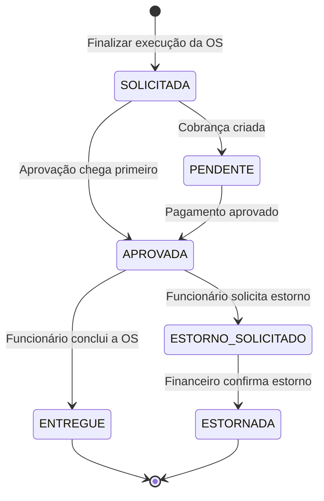

# Saga de pagamento da ordem de serviço

O núcleo coordena a cobrança após a finalização técnica da OS. O financeiro cria a cobrança, acompanha o provedor e confirma o pagamento ou estorno por RabbitMQ. O núcleo mantém o estado da Saga e libera a entrega mediante confirmação financeira.

## Fluxo



A OS permanece `FINALIZADA` durante a cobrança e a compensação. `ENTREGUE` é registrado quando o funcionário conclui a entrega. Para uma OS com valor zero, a finalização e a entrega ocorrem sem cobrança. O valor cobrado é arredondado para centavos com HALF_UP, inclusive quando uma peça tem quantidade fracionada. Cada OS com cobrança tem uma Saga nesta implementação. Uma Saga estornada encerra o fluxo financeiro e mantém a entrega bloqueada.

A migration `V15__saga_pagamento.sql` cria `os_pagamento_saga` e `os_pagamento_outbox`. A finalização da OS, a criação da Saga e a inclusão do comando na outbox ocorrem em uma transação. O estorno também grava a mudança de estado e o comando juntos.

O núcleo mantém um bloqueio sobre a Saga ao registrar a entrega ou solicitar o estorno. Se a entrega for registrada primeiro, o estorno é rejeitado. Se a solicitação de estorno for registrada primeiro, a entrega é rejeitada. Falhas temporárias de publicação deixam o comando pendente para nova tentativa. Um estorno confirmado reverte o pagamento, preservando o histórico da execução técnica.

## Integração

| Direção | Routing key | Fila |
|---|---|---|
| Núcleo → financeiro | `pagamento.criar.v1` | `financeiro.pagamento.criar` |
| Núcleo → financeiro | `pagamento.estornar.v1` | `financeiro.pagamento.estornar` |
| Financeiro → núcleo | `pagamento.criado.v1` | `nucleo.financeiro.eventos` |
| Financeiro → núcleo | `pagamento.aprovado.v1` | `nucleo.financeiro.eventos` |
| Financeiro → núcleo | `pagamento.estornado.v1` | `nucleo.financeiro.eventos` |

O exchange direto `oficina.financeiro` e os bindings são declarados pelos dois serviços. As mensagens rejeitadas são encaminhadas às respectivas filas de mensagens com falha (DLQ), com sufixo `.dlq`. O núcleo confere Saga, OS, valor, moeda e identificadores do pagamento antes de aplicar a transição. Eventos repetidos e eventos de criação atrasados não repetem efeitos nem fazem a Saga regredir.

Os comandos são gravados independentemente do perfil. O publicador e o consumidor de resultados são ativados pelo perfil `rabbit`. Núcleo e financeiro precisam usar o mesmo broker e virtual host. Os bancos permanecem separados.

## Executar localmente

Use o RabbitMQ já compartilhado pelo núcleo e pelo catálogo de produtos. O exemplo abaixo considera aplicações Java executadas na máquina e o broker disponível em `localhost:5672`.

1. Inicie o PostgreSQL do núcleo, o RabbitMQ compartilhado e o catálogo de produtos.
2. No repositório do financeiro, inicie apenas o PostgreSQL financeiro e o mock:

```bash
docker compose up --build -d postgres-financeiro provedor-mock
```

3. Execute a API financeira no IntelliJ ou com `sh mvnw spring-boot:run`, usando:

```text
SPRING_PROFILES_ACTIVE=local,rabbit
RABBITMQ_HOST=localhost
RABBITMQ_PORT=5672
RABBITMQ_USERNAME=oficina
RABBITMQ_PASSWORD=oficina-local
```

4. Execute o núcleo com `SPRING_PROFILES_ACTIVE=dev,rabbit` e as mesmas variáveis de RabbitMQ. Mantenha a configuração de acesso ao catálogo de produtos.

Ajuste host, porta e credenciais conforme o broker compartilhado. Se o ambiente utilizar o broker isolado do Compose financeiro, ele publica a porta `5673`. Nesse cenário, configure também o catálogo para publicar nesse mesmo broker, preservando os eventos de estoque. Em container, utilize um endereço acessível a partir da rede do container.

O seed de desenvolvimento finaliza a execução técnica das OS de exemplo e gera as cobranças. A entrega ocorre somente após a confirmação do pagamento.

## Roteiro de teste integrado

Use um JWT de funcionário nas chamadas ao núcleo. O prefixo dos endpoints abaixo é `/api/ordens-servico/{osId}`.

1. Para uma OS em execução com todos os serviços concluídos, chame `POST /finalizar-execucao`.
2. Consulte `GET /pagamento`. O estado começa como `SOLICITADA` e passa para `PENDENTE` quando a cobrança é criada. O resultado fornece `sagaId`, `pagamentoId` e `provedorId` conforme a integração avança.
3. Tente `POST /concluir` antes do pagamento. A operação é rejeitada e a OS permanece `FINALIZADA`.
4. No [Swagger do mock](http://localhost:8090/swagger-ui.html), autorize `MockAdminKey` com a chave local configurada e execute `POST /simulacao/pagamentos/{provedorId}/aprovar`.
5. Aguarde `GET /pagamento` retornar `APROVADA`. O núcleo ainda deve mostrar a OS como `FINALIZADA`.
6. Chame `POST /concluir`. A OS e a Saga passam para `ENTREGUE`.

Para testar a compensação, use outra OS com pagamento aprovado. Antes da entrega, solicite `POST /pagamento/estorno` com JWT de administrador ou atendente. O retorno `202` indica solicitação registrada. A Saga passa por `ESTORNO_SOLICITADO` e chega a `ESTORNADA` após a confirmação. A OS permanece `FINALIZADA` e a entrega é rejeitada.

Uma OS com cobrança finalizada antes da adoção da Saga pode iniciar o pagamento ao repetir `POST /finalizar-execucao`. A repetição em uma OS com Saga existente não gera uma segunda cobrança. A consulta retorna `404` enquanto não houver Saga para aquela OS.

No webhook de status, as ações `FINALIZAR_EXECUCAO` e `CONCLUIR` exigem também JWT de funcionário, além do header já utilizado pelo webhook.

## Testes da integração com PostgreSQL

Use um banco isolado cujo nome termine em `_test` e configure as variáveis `SPRING_DATASOURCE_URL`, `SPRING_DATASOURCE_USERNAME` e `SPRING_DATASOURCE_PASSWORD` para ele. Habilite `NUCLEO_SAGA_INTEGRATION_TESTS=true` e execute:

```bash
sh mvnw -Dtest=PagamentoSagaPostgresTest test
```

A suíte verifica a entrega após confirmação, a compensação e o rollback conjunto de OS, Saga e outbox. O roteiro funcional valida adicionalmente o transporte real no RabbitMQ e a comunicação com o financeiro e o mock.
